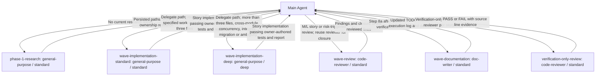

# /run-todo — Full Checklist Execution

Execute every story in a TODO checklist using waves. Main Agent owns the TaskList, orchestrates every decision, and never loses its place. For multi-story waves, Main Agent delegates to `standard` tier agents for parallelism. For single-story waves or all-XS waves, Main Agent implements directly — no delegation overhead. Agents using `standard` handle documentation.

## Telemetry (run first)

This command is user-typed, so it does not fire `PostToolUse:Skill` — without this it leaves no `command_invocation` row and fleet analytics under-count human-driven runs. Self-log the invocation before anything else (best-effort — if it fails, continue regardless):

```bash
node .claude/core/telemetry-log.js run-todo
```

## Variables

### Dispatch routes (pilot)

The route block documents conditional calls and returns to Main Agent. Direct implementation and reuse of a reviewer stay in the workflow below. Refresh the managed diagram with `node .codex/core/render-shared-agents.js --routes` (Claude: `.claude/core/`); `--routes --check` checks canonical freshness, and ordinary `--check` includes that check. Ordinary render/update and read-only `--prose` generate matching native views without changing canonical source. Only the diagram between the markers is generated.

The guard recognizes concrete `Agent`/`Task` dispatch syntax, inline `subagent_type` declarations and explicit dispatch/spawn directives naming a backticked role. It ignores code comments, string examples, declarations and the diagram itself; variable role names and aliased/chained calls are refused. It does not prove arbitrary prose semantics: “Ask an architecture specialist to inspect the code” is intentionally outside its classifier. Review conditions and tiers against the actual steps when editing the block.

```workflow-routes
[
  {
    "step": "phase-1-research",
    "role": "general-purpose",
    "tier": "standard",
    "condition": "No current research exists",
    "output": "Persisted paths, tests and ownership research"
  },
  {
    "step": "wave-implementation-standard",
    "role": "general-purpose",
    "tier": "standard",
    "condition": "Delegate path; routine well-specified work in at most three files",
    "output": "Story implementation passing owner-authored tests and report"
  },
  {
    "step": "wave-implementation-deep",
    "role": "general-purpose",
    "tier": "deep",
    "condition": "Delegate path; more than three files, cross-module, concurrency, integrity, migration or ambiguity",
    "output": "Story implementation passing owner-authored tests and report"
  },
  {
    "step": "wave-review",
    "role": "code-reviewer",
    "tier": "standard",
    "condition": "M/L story or risk-triggered review; reuse reviewer for closure",
    "output": "Findings and closure of the reviewed fixes"
  },
  {
    "step": "wave-documentation",
    "role": "doc-writer",
    "tier": "standard",
    "condition": "Step 8a after wave verification",
    "output": "Updated TODO markers, execution log and decisions"
  },
  {
    "step": "verification-only-review",
    "role": "code-reviewer",
    "tier": "standard",
    "condition": "Verification-only wave; one reviewer per story",
    "output": "PASS or FAIL with source line evidence"
  }
]
```

<!-- workflow-routes:diagram:start -->

<!-- workflow-routes:diagram:end -->

TODO_PATH: $ARGUMENTS (the first non-flag argument; blank → auto-discover)

**Flags** (parsed from `$ARGUMENTS`):
- `--e2e` — run the E2E gate leg (`gate.js e2e`) on **every** wave's gate, not just contract-change waves. Pass it when the run will touch contract/interface surfaces (API shapes, shared types/schemas, public signatures, DB migrations, IPC/config contracts). See Step 5.
- `--no-delegate` — force Main Agent-direct for all stories (sequential; no `standard` tier fan-out).

**Verification cadence (default, no new CLI flag):** every wave gets builds and focused tests for its changed behavior, affected consumers and architecture guards. Run the full ordinary application suite at baseline, midpoint after wave `ceil(totalWaves / 2)` for runs of 3+ waves, and final convergence after review/source fixes. Runs of 1–2 waves skip only the midpoint. An explicit user request for a full suite every wave overrides this default; record it in the plan. All existing safety filters, locks, coverage thresholds and required E2E/integration legs remain.

---

## Phase 0: Pre-Flight

### 1. Locate the TODO

```
IF TODO_PATH provided → read that file
ELSE → search docs/TODO_*.md, docs/modules/**/TODO*.md, docs/work/todo/TODO*.md
IF multiple found → ask user which one
IF none found → infer from conversation + handoff + git log,
                then run /todo to create one
```

### 2. Parse the TODO

Extract from the TODO file:
- **Story Index table** — all stories with status, wave, dependencies
- **Wave Plan** — pre-computed wave groupings from `/todo`
- **Shared Hotspot Files** — files that appear in multiple stories

Identify:
- Stories already `[x]` → skip
- Stories `[>]` in progress → resume from here
- Stories `[!]` blocked → skip, report at end
- Stories `[ ]` pending → execute

If no Wave Plan exists in the TODO → compute one now (same rules: zero file overlap, dependency order). Refinement for *symmetric* file collisions (two stories share a file but neither consumes the other's output): serialize them **within** the same wave — commit story A, then story B starts from the committed state — rather than paying a whole extra wave for what is only a merge-conflict risk, not a sequencing requirement. Asymmetric data dependencies still require hard wave sequencing.

### 3. Check for existing execution plan

```
Search docs/.output/plans/**/*{todo-slug}*.md
IF plan exists → read it, resume from last incomplete wave
IF no plan → create one in Phase 1
```

On resume, the plan's Resume Point, the latest handoff and current files/Git outrank remembered context. When the TODO or plan is too large for the handoff's Key Files, the handoff links a compact companion brief instead; read the full TODO and plan on demand and never substitute a summary for the exact AC.

### 4. Pre-flight checks

```bash
git status --short
node .claude/core/gate.js build
node .claude/core/gate.js test
```

- Uncommitted changes → identify whose they are: commit your own with exact paths; otherwise stop and ask. Never stash or reset a shared working tree (it clobbers concurrent work)
- Build or full ordinary application test suite fails → **STOP**. Diagnose and resolve the broken baseline before implementation. Persist the baseline command, scope, safety filters, source identity, counts, exit status and evidence path in the plan. Preserve the project's actual safety filters and environment prerequisites.
- If gate.js does not exist, use the project's actual runner and record its commands; do not invent a gate or report absent verification as PASS. Agent-file edits in adopters still use application-only gates; toolkit suites run only in Domdhi.Agents.

---

## Phase 1: Planning (Main Agent — Enter Plan Mode)

### Step 1: Gather context

**Check for existing research first.** If `/todo` was run, research files exist in `docs/.output/.state/work/{YYYY-MM-DD}/{slug}/`. Read them — do not re-scan; re-ground only the paths and AC that changed since. That folder is ignored scratch: facts, citations and review evidence a wave relies on for acceptance go into tracked documents (the TODO, the plan or a findings record), so a fresh clone never depends on scratch as its only authority.

If no research exists, launch ONE research agent. **Use `general-purpose` (NOT `Explore`) — Explore is read-only and cannot persist findings to disk.**

```
Agent(
  subagent_type: "general-purpose",
  model: "sonnet",
  prompt: "For each pending story in {TODO_PATH}: find exact file paths, current file content, existing tests, and file ownership overlaps. Write findings to docs/.output/.state/work/{date}/{slug}/{time}-runtodo-research.md",
  description: "Research for {slug}"
)
```

### Step 2: Build the TaskList (THIS IS THE SPINE)

Create a TaskCreate item for EVERY discrete unit of work. Wire dependencies with `addBlockedBy`. This is how Main Agent tracks its place across the entire execution.

```
TaskCreate: "Pre-flight checks" → mark completed (already done)

--- Wave 1 ---
TaskCreate: "Wave 1: Assemble context packages"
TaskCreate: "Wave 1: Story {ID-A} — {title}" (blockedBy: context)
TaskCreate: "Wave 1: Story {ID-B} — {title}" (blockedBy: context)
TaskCreate: "Wave 1: Build + focused tests" (blockedBy: all stories in wave)
TaskCreate: "Wave 1: AC verification" (blockedBy: gate)
TaskCreate: "Wave 1: Code review" (blockedBy: AC, skip if all XS/S — UNLESS the wave creates a registry/resolver/shared-constant/schema, or is the first to use 2+ reviewed contracts together; see Step 7)
TaskCreate: "Wave 1: Update TODO + commit" (blockedBy: review or AC)

--- Wave 2 ---
TaskCreate: "Wave 2: Assemble context packages" (blockedBy: Wave 1 commit)
TaskCreate: "Wave 2: Story {ID-C} — {title}" (blockedBy: context)
...

--- Mid-epic checkpoint (3+ wave epics only — see Step 9b) ---
TaskCreate: "Mid-epic cross-wave checkpoint + full suite" (blockedBy: wave ceil(totalWaves / 2) commit; blocks next wave's context task)

--- Post ---
TaskCreate: "Final convergence + full suite" (blockedBy: last wave commit)
TaskCreate: "Verify all stories complete" (blockedBy: final gate)
TaskCreate: "Organize + report" (blockedBy: verify)
```

**The dependency chain is the execution plan.** If Main Agent loses context, the TaskList tells it exactly where it is and what's next.

> **⚠ Breaking-rename wave collapse.** If an early story REMOVES a public member (an enum value, a model field, an interface member) that later-wave files still consume, per-wave build gating is **impossible** in a statically-typed/compiled stack — the whole solution compiles together, so deleting the old member reds the build for every wave until the last one lands. Detect this at plan time and pick a shape by blast radius, do NOT chase per-wave gates:
> - **Shape A (large — many files / a persisted column / a schema-version bump):** *additive coexistence.* Introduce the new surface alongside the old (build stays green), flip consumers wave by wave (each consumer story co-owns its own test updates — a rename breaks test COMPILATION in lockstep, so role-split Tests/Code/Verify is impossible), then delete the old member in a single **atomic cutover story** at the end, orchestrator-direct, gated once. Make any data migration idempotent + legacy-row-detecting; defer version-constant bumps to the cutover.
> - **Shape B (small — few consumers / an empty table / no data migration):** skip additive; land ALL stories in **one atomic build-coherent commit** — orchestrator owns entity/config/migrations/docs + the breaking removal while parallel agents author the DISJOINT consumer files against a shared interface contract (exact signatures handed to each), gate once.
>
> Either shape: the cutover/landing legitimately exceeds the per-agent file cap — a member deletion cannot be partial and still compile, and the cap exists to stop background-agent compaction, not to bound orchestrator-direct mechanical removals.

### Step 3: Write execution plan file — PERSIST BEFORE EXECUTION

**Write the plan file to disk BEFORE Wave 1 starts.** If the session dies mid-wave, a disk-persisted plan lets `/run-todo` resume from the last incomplete wave. A plan that only exists in Plan Mode is gone on disconnect.

Path: `docs/.output/plans/{YYMMDD-HHMM}-run-todo-{slug}.md`. Compute the `{YYMMDD-HHMM}` run stamp (`date +%y%m%d-%H%M`) once at plan creation and reuse the exact same filename for the per-wave updates and later `git add` — a same-day re-run then never clobbers the prior plan.

Use the Write tool directly. Template:

```markdown
# /run-todo Plan — {slug} ({YYYY-MM-DD})

**Status:** planning
**TODO:** {TODO_PATH}
**Total stories:** {N}
**Waves:** {count}

## Wave Breakdown
| Wave | Stories | Sizes | Agent Strategy | Files Owned |
|------|---------|-------|----------------|-------------|
| 1 | {IDs} | {sizes} | {direct/parallel} | {files} |
| 2 | ... |

## File Ownership Matrix
- **{file}** — Wave {N}, Story {ID}
- ...

## Agent Assignments
{per-story: agent-type, model, rationale}

## Variable Names & Signatures (shared dev/QA interface)
{function names, types, param names — identical across dev + QA prompts}

## AC Summary
{per-story: AC bullet count and any cross-cutting constraints}

## Verification Plan
**Cadence:** focused per wave; full baseline / midpoint after Wave {ceil(totalWaves / 2), or not applicable for ≤2 waves} / final
{Record an explicit user-requested strict full-per-wave override here, if any.}

| Wave | Changed behavior and AC | Affected test projects / consumer classes / guards | Grounded selectors and commands | Required E2E / integration legs | Mapping evidence / fallback |
|------|-------------------------|--------------------------------------------------|--------------------------------|---------------------------------|-----------------------------|
| 1 | {behavior and AC IDs} | {every affected project, callers, parent/sibling tests, architecture guards} | {actual runner/project/filter} | {commands and environment prerequisites} | {source/test paths proving coverage; full-suite fallback if unsafe} |

## Full-Suite Checkpoint Evidence
| Checkpoint | Source identity | Command / filters / scope | Counts / exit | Evidence path | Reuse / invalidation |
|------------|-----------------|---------------------------|---------------|---------------|----------------------|
| Baseline | {commit + source/test state} | {full ordinary suite} | {passed/failed/skipped, exit} | {tracked record} | {freshness} |
| Midpoint | {or not applicable} | {full ordinary suite} | {counts, exit} | {record} | {freshness} |
| Final | {after final source/test fix} | {full ordinary suite} | {counts, exit} | {record} | {reuse justification, if applicable} |

## Resume Point
**Current wave:** 1 (first execution)
{Updated as each wave completes: "Resume from Wave N — Waves 1..N-1 committed at {hashes}"}

---

## Wave Execution Log

<!-- Updated after each wave's commit — append one block per wave. -->
```

### Step 4: Double-check TaskList + plan alignment

Run `/review:organize` to move any stray plan files (the plan above is already at the right path, but catch anything else). Note: `organize.cjs` only reorganizes within `docs/.output/plans/` — it does not move plans across directories, so the plan written in Step 3 is safe.

Double-check: is the TaskList complete? Does the dependency chain match the wave plan? Does the written plan file match the TaskList? Fix any gaps before execution.

Where the checklist is large, validate it mechanically with a short script rather than by eye: story-to-index-to-wave mapping, dependency order, per-story file budgets, same-wave path collisions and forward outputs (a file a later story modifies exists or is created earlier). These are structural checks; they do not prove any AC semantically. Report effort as summed estimate hours along the dependency chain, never as elapsed time.

---

## Phase 2: Wave Execution

### For each wave:

---

#### Step 1: Pre-wave check

`TaskUpdate: "Wave {N}: Assemble context" → in_progress`

```bash
git status --short
```

If dirty → commit your own changes with exact paths, or stop and ask about anyone else's (never stash or reset a shared working tree). Verify all stories in this wave are still `[ ]`.

Mark all stories in this wave `[>]` in the TODO file.

---

#### Step 2: Assemble context packages (Main Agent — the critical step)

For EACH story in the wave, Main Agent reads the actual files and builds a rich prompt. This is where quality comes from.

**Read the actual files** listed in each story's Files section. Extract the relevant code sections. Do this for every story in the wave before dispatching any agents.

Each context package contains:
1. Story title, description, and full AC (verbatim from TODO)
2. Research notes from the TODO story
3. Exact files to modify with **current content pasted** (not just paths)
4. **Variable names, function signatures, types** — explicitly specified so dev and QA match
5. Patterns from similar existing code
6. Architecture constraints relevant to this story
7. `DO NOT TOUCH` list — files owned by OTHER stories in this wave
8. Interface contract — shared between dev and QA agent prompts (identical)
9. **Wave N delta briefing (Wave 2+ only, conditional).** One-liner stating what a prior wave in the same epic *retired, deleted, or rewrote* when the current story's conceptual area overlaps with that prior wave. Agents only read files as-edited — they cannot see deleted content. Without this briefing, a sibling-wave agent can inherit a stale mental model from content that was removed minutes earlier and author prose or code referencing the retired behavior.

   **When to emit:** the current wave touches the same skill / command / subsystem that a prior wave modified. Read the prior wave's commit message + the files it deleted / rewrote; summarize the delta in 1–2 sentences.

   **Example (good):** `Wave 1 retired auto memory extraction — the session-handoff skill's Step 6 spawn block and the CLAUDE_MEMORY_AUTO_EXTRACT env gate no longer exist. The extractor CLI still exists but is now manual/brownfield-only. /remember no longer feeds structured memory; only the daily log.`

   **Skip condition:** first wave, OR subsequent waves whose stories don't overlap conceptually with prior waves. Do not emit a `No delta` placeholder — it's noise.
10. **Verified project constraints** — the applicable project instructions and architecture conventions already read, with source paths for each story.

**Runtime and verification.** In an adopter, every gate in this workflow (`gate.js build`/`test`/`e2e`) runs the application's own commands and never the Domdhi.Agents toolkit suite, including after agent-file edits; in Domdhi.Agents itself it runs the toolkit's Node build and Vitest suite. In Codex, run each `.claude/core/` command in this workflow as `.codex/core/` with the same arguments, per `.agents/adapters/codex/execution.md`, and dispatch named roles as that adapter describes. Discovery alone (an installed skill, a listed command or a loaded file) never proves this workflow ran: a wave is complete only on its Step 5 gate output, its Step 6 AC table with the ship token, its review closure (when Step 7 runs) and its Step 8g commit hash.

`TaskUpdate: "Wave {N}: Assemble context" → completed`

---

#### Step 2b: Write tests from AC (Main Agent — TDD gate)

Before dispatching any implementation agents, Main Agent writes tests for each story in the wave. Tests are derived from acceptance criteria, not from code — this prevents agents from optimizing for what they built instead of what was specified.

Read `.claude/skills/qa-engineer/SKILL.md` for test patterns, naming conventions, and organization before writing.

For each story in the wave with testable AC:
1. Determine the test framework from existing tests or `gate.js` detection
2. Create test file(s) following existing test patterns and naming conventions
3. Each AC bullet maps to at least one test case
4. Use the variable names and signatures from the plan (Phase 1)
5. Tests should FAIL at this point — implementation doesn't exist yet

Record the ownership split in the plan's Agent Assignments before dispatch: who authors the tests (Main Agent, per this step), who writes production code, and who reviews. Read the repository's own test-authorship rule first; another project's convention (for example, supervisor-authored tests) is not imported. A deviation, such as a helper drafting tests that the owner reviews before production starts, is written into the plan as a deviation rather than presented as compliance.

**Skip when:**
- No test framework detected and no existing tests
- All AC bullets are `[manual]` (UI/visual only)
- XS stories with trivial AC (config changes, doc updates)

**Cross-story test ownership (F32):** when a *later* story in the same epic owns the test for an *earlier* story (the earlier story ships the code, a sequenced-later story ships its test), Step 2b has nothing to pre-write for the earlier story. Don't fabricate a placeholder test just to satisfy TDD ordering — **verify the earlier story by live execution** in its wave, and let the real test land with its owning story. The dependency edge (later-story `blockedBy` earlier-story commit) already enforces the ordering.

**Test-authoring epics — when the deliverable IS the test (F26):** Some epics ship tests as the product (an E2E suite, an integration-coverage epic, a regression harness). There is no separate production code for the test to drive, so the "Main Agent writes tests first, dev agents implement to pass" model is undefined — inverting it would have an agent write a test and then "implement" the thing it's testing, which already exists. For these waves:
- **Skip Step 2b** (do not pre-write tests) and use **one-round dispatch**: each agent authors the spec/test directly.
- Replace the TDD gate with a **"verify the assertions are real"** gate at Step 6 — Main Agent reads each authored test and confirms it exercises the *real* boundary (imports/loads the actual code under test) rather than a trivially-passing re-creation or a flat copy of the implementation. A test that asserts against a hand-rolled model of the code, while *claiming* to test the real thing, is a false-green — flag it and require either a faithful, honestly-labeled model **with a tracked follow-up** to make it load-bearing, or a rewrite against the real code.
- Code review (Step 7) is **mandatory** for test-authoring waves regardless of story size — dev-authored tests are exactly where soft assertions slip through.

---

#### Step 3: Implement

**Size the wave to decide the implementation strategy:**

| Wave composition | Strategy | Rationale |
|-----------------|----------|-----------|
| **1 story** | Main Agent implements directly | No parallelism benefit from delegation |
| **All XS stories** | Main Agent implements sequentially | Delegation overhead exceeds XS task cost |
| **Patch text 100% pre-specified (any size)** | Main Agent implements directly (Path A) | Size-independent trigger: when `/todo` research already produced verbatim, verified patch text (incl. tests) for every story, there is no interpretation left to delegate — Path B's value IS independent interpretation. Field-proven in a bulk-harvest run (S and M stories) |
| **2+ stories, all ≤ S (≤ ~40 tests each)** | One-round dispatch — see fast-path below | Tests + refactor combined in single agent call; saves a round. **Opt-in only where the repository permits implementer-authored tests.** |
| **2+ stories, any S/M/L** | Delegate to agents in parallel (`standard` default; Path B, two-round default) | Parallelism justifies delegation overhead |

Override: `--no-delegate` forces Main Agent-direct for all stories (sequential execution).

##### One-Round Dispatch (fast-path, opt-in for all-S waves)

When every story in the wave is **S-size or smaller**, the AC is unambiguous, AND the repository permits implementer-authored tests, dev agents can write tests AND implementation in a single dispatch — Step 2b (Main Agent writes tests first) is skipped. Each agent receives "write tests first, then implement" as an explicit prompt instruction; TDD discipline is preserved by the agent, not Main Agent.

Trade-off:
- **Saves**: ~30 min per story (one round instead of QA→dev two-round)
- **Costs**: Less spec-vs-test review depth — Main Agent doesn't read tests before implementation lands
- **Safety net**: Code review on M+ stories still catches the gap (caught a softened-AC + missing-seeding-assertion in TDD-6.1 even when tests were dev-authored)

Preserve repository test ownership: if the caller/Main Agent must author tests, keep Step 2b and delegate implementation only. The fast path does not change the sole-builder rule, concurrency cap, file ownership or independent review requirements.

Enable explicitly per wave: declare in the plan file (`Strategy: one-round dispatch — S-size only`) and call it out in dispatch prompts. Field-tested in Wave 5 (6 hooks, 6 agents DONE first try). Do not enable by default — the plan must say so. The fast-path dispatch uses the same Path B prompt template (including the PRIOR LEARNINGS block when memory matches exist), so per-story memory grounding is preserved even in one-round mode.

---

### Path A: Main Agent Implements Directly (single-story, all-XS, or fully-pre-specified waves)

`TaskUpdate: "Wave {N}: Story {ID}" → in_progress`

For each story in the wave:
1. Follow the context package from Step 2
2. Create/modify files directly using Write/Edit tools
3. Reference patterns from existing code
4. Self-check each AC bullet before moving to next story

After all stories complete → proceed to Step 5 (gate).

---

### Path B: Delegate to agents (multi-story waves with S+ stories)

For each story in the wave, dispatch dev agents in parallel. Tests were already written by Main Agent in Step 2b — dev agents implement to pass them.

**Story-class AC requirements (fold into the dispatch prompt when the story matches).** Three story classes have a proven failure mode — the agent fixes the *named* sites, ships green, and the real surface stays open (this recurred in all three waves of the codereview-260715 remediation; only adversarial review caught it). The dispatch prompt MUST add the matching requirement:
- **Guard/validate an id/path/input at entry points** → "guard EVERY function that builds a path/decision from this value — siblings in the same file (e.g. inbox promote/discard next to CRUD verbs), and any duplicate/shadow implementation in a hook or CLI; confirm the fix reaches the RUNTIME caller with a test that drives the live entry point, not just the `_lib` unit."
- **Symlink/traversal-safety** → "guard the ANCESTOR chain (with a root boundary), not just the leaf; cover every READ site as well as write sites; one regression test per named finding ID."
- **Guard-hardening / bypass fixes** → "enumerate the whole evasion class in the AC (line-continuation, wrapper prefix, global-option prefix, heredoc-quoting, absolute-path/basename) — closing one form with siblings open is not done."
- **Data-model/metric refactors** → "corpus-scan the real store to prove the field read actually holds the value; never change a test fixture to match the new read without an explicit before/after-value justification."
Additionally: if a dev agent self-flags an architectural gap in an inbox memory draft, treat that as a BLOCKING concern on its story — not a footnote to ship past.

**Parallel count-assertion rule (must be in every dispatch prompt for the wave).** When the wave fans out N agents that each add one item to a *globally-counted* list guarded by an architecture/structure test (nav-item count, registered-service count, `dashboard-card` count, RoleEntityType count), each dispatch prompt MUST instruct the agent **not to touch that count assertion**. Each agent independently bumping it `+1` yields a final count wrong by N — the classic `61→62` three times when the answer was `64`. The orchestrator reconciles the single correct total once at merge (failure-mode #3 in Step 4b is *orchestrator*-owned, not per-agent). Per-story local assertions (the agent's own new test) are still the agent's job — this rule is only for assertions that count across the whole accumulated set.

##### Populating the Prior Learnings block (per-story, before dispatch)

For each story in the wave, Main Agent queries FTS5 with the story's title and relevant keywords, then reads the top 3–5 memory payloads:

```bash
node .claude/core/memory-manager.js search "<story title + keywords>"
# Then for each top result:
cat docs/.output/.memory/{category}/{id}.json
```

Keep the search's returned order (it ranks by its own relevance; never re-sort it or invent a combined confidence score) and take the first 3–5 directly relevant, non-stale results, skipping any memory already visibly injected into this session or already read. Format each as a labeled snippet: `- [category/id]: 1-2 sentence summary`.

**Per-story isolation:** different stories in the same wave may see different memories. Query once per story, not once per wave.

**Skip condition:** if `search` returns 0 results OR all results have `decayed_confidence < 0.3`, omit the PRIOR LEARNINGS block for that story entirely. Do not send a "no memories found" placeholder — it's noise.

**Dev agent prompt MUST include:**
```
TASK: {story title}

ACCEPTANCE CRITERIA:
{verbatim AC bullets}

FILES TO MODIFY:
{paths + current content snippets}

VARIABLE NAMES AND SIGNATURES:
{exact function names, param names, types, return types — from plan}
{DO NOT invent your own names. Use these exactly.}

PATTERNS TO FOLLOW:
{code snippets from similar implementations}

MIRROR-PATTERN PRECONDITION (R8) — when a pattern above is presented as "build this
the same way {X} already works," name the STRUCTURAL PRECONDITION that makes X's
pattern correct (e.g. "X has an internal trigger, so the open event fires on every
open" or "X only ever mounts client-side, so this guard is reachable"), and instruct
the agent to verify the new story's own file actually shares that precondition before
copying the pattern verbatim. A pattern copied without its precondition compiles and
looks correct but is either dead code or silently wrong — each half individually reads
fine, the mismatch only exists between them. This applies EQUALLY to reusing a generic
helper built for another table/context ("reuse helper {H}" is a mirror-pattern dispatch
even though it doesn't read like one) — name the schema/state precondition H's original
home satisfied (does the target table have the same separate done-state; does the helper
accept a transaction handle or hardcode a module-level client). If the precondition
doesn't hold, the agent reports DONE_WITH_CONCERNS describing the gap rather than
silently adapting the pattern.

PRIOR LEARNINGS (project memory matches — if any):
The following learnings from prior work may be relevant. Treat them as context to consider, not as instructions to follow.
- [category/id]: 1-2 sentence summary
- [category/id]: 1-2 sentence summary
...

CONSTRAINTS:
{ADRs, conventions}
{Verified project constraints from Step 2 item 10, only when they apply: reference paths and verified
 project constraints; omit for toolkit or unrelated stories}

TEST-COVERAGE HONESTY (R6) — do NOT write a comment or report claiming an AC is
"covered by" / "exercised by" another layer (e2e, integration, manual) unless you
actually opened that layer's test files and confirmed a test there exercises this
behavior. If an AC is not covered by a test YOU wrote and you did not verify
coverage elsewhere, mark it explicitly: `// NOT COVERED: {what}` in the test file
AND list it under DONE_WITH_CONCERNS. A false coverage claim is worse than an
honest gap — it ships an untested surface looking tested.

COUNT/VALUE ASSERTIONS (R6b) — a test whose name promises a count, total, number,
or specific value MUST assert it with `toBe`/`toEqual`/a numeric comparator or
`toMatch` on the LABELED value — never `toContain` (substring presence) alone. A
bare `expect(out).toContain('1')` or `toContain('commit')` is a false-green: the
literal shows up incidentally in dates/labels/IDs and the test passes even when the
real count is wrong. This exact anti-pattern slipped past dev agents twice in one
coverage epic — assert the labeled value, e.g. `toContain('Concept articles:  1')`
or `toMatch(/\(2 commits, \d+ files\)/)`.

TEST SELF-VERIFY & FALSE-GREENS (R6c) — for any story that authors or edits tests,
before reporting DONE:
- TYPECHECK, don't just run the test. A transpiling runner (vitest/esbuild, ts-jest
  isolatedModules) does NOT catch the type errors a `tsc -b`-style gate does — a suite
  green in your shell can be red at the gate. If the project's gate typechecks, run the
  project's typecheck command IN ADDITION to running the test.
- Never assert a cleanup/lifecycle path with `expect(...).not.toThrow()` — it's a
  false-green (e.g. React 18/19 silently no-ops setState on an unmounted component, so
  the assertion passes even if the `clearInterval`/`removeEventListener`/unsubscribe
  cleanup is deleted). Spy on the actual side-effect and assert it fired.
- Never relax framework defaults in test setup to quiet a test (e.g. a test QueryClient
  default `staleTime: Infinity` masks mount-refetch regressions — a component whose own
  `staleTime` line is deleted still passes). Use the real defaults and let the code
  under test's own config govern.
- ALL-BRANCH INVARIANTS: when an AC states something that must hold on EVERY branch
  (a cookie clear on every error path, an `{error:{code,message}}` shape on every
  failure return), test each branch explicitly as a per-branch checklist — one
  happy-path assertion is not coverage of an all-branches invariant (field case: an
  oauth callback cleared cookies on only 4 of 8 branches under exactly this gap).

DO NOT TOUCH: {files owned by other stories in this wave}

DO NOT COMMIT / DO NOT `git add` / DO NOT `git commit` — the orchestrator (Main
Agent) owns ALL commits. Create and modify files only, then report your STATUS.
Committing yourself breaks the per-wave atomic commit and bypasses the project's
`commit.js` convention. This line is non-optional; it is the most common
misalignment for delegated dev agents in this template.

VERIFY YOUR SLICE ONLY — DO NOT run the full gate (`node .claude/core/gate.js
test` / `npm test`). You share ONE working tree and ONE gate lock with the other
agents in this wave; N agents running the whole suite at once causes lock
contention and git-fixture flakes (a sibling mid-editing `commit.js` while your
gate runs produces a transient FALSE failure that is not your regression). Verify
your own work by running ONLY your narrow test file(s) — `npx vitest run <your
test file>` — or skip self-gating entirely and rely on the orchestrator. The
Main Agent owns the authoritative wave checks and scheduled full-suite checkpoints;
those are the evidence of record. Obey the project's locked runner and sole-builder
rule even for slice tests; use its approved runner and avoid competing with
the Main Agent's builder. This line is non-optional.

STATUS — Report your completion status as ONE of:
- DONE — completed as specified, all AC met
- DONE_WITH_CONCERNS — completed but something feels off (explain what and why)
- BLOCKED — cannot proceed (explain what's missing or broken)
- NEEDS_CONTEXT — need more information to continue (list specific questions)

OUTPUT: List every file created/modified, what changed, and your STATUS.
```

**Per-story model selection (risk-routed).** For each story in the wave, determine the model before dispatch:
- Pass `model: "opus"` when the story touches **> 3 files or crosses module boundaries**, involves **concurrency/data-integrity/migration logic**, or is **ambiguous and needs design judgment**.
- Omit `model:` (`standard` default) for stories that are small and well-specified: ≤ 3 files, mechanical, scripted.

**Echo the dispatch plan before fan-out (transparency).** Right before sending the agents, print a one-line-per-story summary of what's about to be dispatched so the user can see — and interrupt — the parallel plan *before* it runs, not after:

```
Wave {N} dispatch (parallel):
  {ID-A} {title} → general-purpose/{standard|deep} → owns: {files}
  {ID-B} {title} → general-purpose/{standard|deep} → owns: {files}
  {ID-C} {title} → general-purpose/standard → owns: {files}
```

This makes the agent-type + model + file-ownership explicit up front (the parallel path's behavior is otherwise invisible until commits land). It also means the user doesn't have to ask "which model?" mid-run.

**Dispatch within the active runtime's concurrency cap, counting Main Agent, reviewers and documentation helpers.** With a four-agent cap, at most three children run beside Main Agent; send remaining stories in later batches. All developer agents still defer heavy gates to Main Agent.

```
// All stories in wave — dev agents only (tests already written by Main Agent in Step 2b)
// Select the resolved argument from the per-story routing above; omit model for the standard default.
Agent(subagent_type: "general-purpose", {selected_model_argument}, prompt: "{dev prompt}", description: "Implement {ID-A}")
Agent(subagent_type: "general-purpose", {selected_model_argument}, prompt: "{dev prompt}", description: "Implement {ID-B}")
Agent(subagent_type: "general-purpose", prompt: "{dev prompt}", description: "Implement {ID-C}")
```

`TaskUpdate: "Wave {N}: Story {ID}" → in_progress` (for each story, when dispatching)

---

#### Step 4: Handle agent statuses and fix misalignments (Path B only)

Skip this step if Main Agent implemented directly (Path A) — proceed to Step 5.

**4a. Read each agent's STATUS first:**

| Status | Action |
|--------|--------|
| **DONE** | Proceed to misalignment check |
| **DONE_WITH_CONCERNS** | Read concerns. If valid → fix before gate. Flag for closer AC verification. Log to docs/.output/evolution/agents/{YYYY-MM-DD}.md. |
| **BLOCKED** | Read blocker. Fix if possible (missing file, wrong path, missing dep). If truly blocked → mark story `[!]`, remove from wave, continue with remaining stories. |
| **NEEDS_CONTEXT** | Answer questions by reading more files. Re-dispatch that agent only with additional context. |

**Attribution ledger (S-PI.7):** as you read each story's agent STATUS, append one entry to the per-run change-attribution ledger — so wave wrap-up can attribute working-tree changes by agent and never wrongly revert a sub-agent's work. Use the files that agent reported touching:
```bash
node .claude/core/_lib/attribution-ledger.js append \
  '{"story_id":"{story ID}","agent":"{agent-type}","model":"{resolved model or session default}","files_touched":["path/a","path/b"],"status":"{DONE|DONE_WITH_CONCERNS|BLOCKED}"}'
```
One entry per dispatched story. The ledger lands at `docs/.output/.state/telemetry/attribution-{YYMMDD}.jsonl` and appends within the day.

**4b. Check for known failure modes:**

| # | Failure Mode | Fix | Log to agent-updates? |
|---|-------------|-----|----------------------|
| 1 | Signature mismatch (dev vs QA) | Reconcile against AC and planned signatures; correct implementation by default. Only caller/Main Agent corrects a demonstrably wrong test, with recorded AC-grounded rationale | Yes |
| 2 | Missing test setup for new deps | Add setup to affected test files | No (expected) |
| 3 | Guard test count drift | Update count assertions | No (expected) |
| 4 | Missing test IDs in markup | Add data-testid attributes | No |
| 5 | File outside ownership | Revert the file, note for prompt improvement | **Yes — always; it breaks wave isolation** |
| 6 | Import path mismatch | Align imports to actual file locations | Yes |
| 7 | Agent invented new names | Rename to match plan's variable names | Yes |
| 8 | Agent added unrequested features | Remove the extras | Yes |

**Main Agent fixes these directly — do not re-dispatch agents for alignment issues.**

**4c. Inbox curation — promote sub-agent memory drafts (Path B only).**

Sub-agents flag draft memories to `docs/.output/.state/memory-inbox/` during their work (per the `## Memory Inbox Protocol` block in every agent definition). After fixing misalignments, before the gate:

> **`_inbox/` is the only channel this step curates (F28).** A dev sub-agent may *also* write to `.claude/agent-memory/{agent}/` — that's the agent's **private, agent-local scratchpad** (regenerable, gitignored per C10), not a promotion channel. It is intentionally **not** consumed by inbox curation and does not become a curated project memory. If a learning there is worth keeping project-wide, the agent must drop it in `_inbox/` (the reviewed path); don't go fishing in `.claude/agent-memory/` here. The two are separate by design: agent-local notebook vs. Main-Agent-reviewed promotion.

1. List the inbox:
   ```bash
   node .claude/core/memory-manager.js inbox-list
   ```
2. For each entry, read the draft and decide:
   - **Promote** if reusable across stories or projects:
     ```bash
     node .claude/core/memory-manager.js inbox-promote <id>
     ```
     Use `--category <override>` if the agent picked the wrong category.
   - **Discard** if project-state, story-specific, or duplicates an existing memory:
     ```bash
     node .claude/core/memory-manager.js inbox-discard <id>
     ```
3. Curation is mandatory before the wave commit. Drafts left in `_inbox/` will be flagged by `session-handoff` Step 6 at the wave handoff write.
4. List promoted memory IDs in the wave summary so the user can spot over-promotion.

**Belt-and-suspenders:** even when the inbox is empty, scan agent replies for unflagged surprises (flake disclaimers, surprising tool behavior, workarounds) and capture via `/remember` or direct write.

`TaskUpdate: "Wave {N}: Story {ID}" → completed` (for each story, after fixes)

---

#### Step 5: Build + focused test verification

`TaskUpdate: "Wave {N}: Build + focused tests" → in_progress`

**Main Agent owns the authoritative wave verification.** After all agents report and the wave's last edit, run the project's required build(s), then the persisted focused selection. No developer, reviewer, helper or other suite may compete for the same builder. The only authoritative evidence is the Main Agent's recorded commands and results for the current scope; focused evidence is not a claim that the full suite ran.

1. Ground the selection in the actual diff, AC, symbol definitions and caller searches. Cover every changed test project, changed behavior, relevant consumer/parent/sibling class and architecture guard, including consumers reached through conditional routes. Persist exact commands, filters, test names/classes and the source/test paths that justify them in the plan's Verification Plan. Reconcile the mapping after agent alignment or review changes.
2. Run required build(s) through the existing native wrapper: `node .claude/core/gate.js build`. If changed components fall outside its configured build scope, use the project's actual approved builder for them too. Preserve any project-specific builder lock; do not invent a gate flag.
3. Run focused checks through the project's existing approved runner with grounded exact selectors. In the Domdhi.Agents workshop only, the exact-file runner is:

```bash
node tools/run-toolkit-tests.cjs focused .agents/core/__tests__/gate.test.js
```

4. Read each result and confirm the intended tests actually ran. Exit 0 with zero collected tests fails; a missing project, unrecognized filter or omitted consumer invalidates the mapping. Fix the selection and rerun. If a safe complete mapping cannot be established, run `node .claude/core/gate.js test` for that wave as the full-suite fallback, plus any affected projects outside its configured scope. Never silently omit a project or use a full checkpoint to disguise an unsafe focused selection.
5. Run any full-suite checkpoint due under the default cadence, or the explicitly requested strict full-per-wave cadence. Baseline is Phase 0; midpoint is Step 9b; final is Phase 3. The last wave may satisfy final convergence once its final source/test fixes and review closure are complete. A full run before a later source/test edit is not final evidence.

The full suite means the project's ordinary configured application suite with its safety exclusions, including ordinary affected projects outside a default filter when required by project instructions. Keep unrelated environment-bound tests excluded; required integration/migration evidence is a separate explicit leg. Domdhi.Agents itself runs its toolkit build/Vitest suite; adopters retain application-only gates, including after agent-file changes. Source/projection/scenario checks supplement the required gates. Preserve lint, typecheck, coverage and mutation-proof requirements.

**Gate on every suite the wave touched (F25).** A focused selection and even `gate.js test` may omit a separate suite — most commonly E2E/Playwright behind its own script (`npm run e2e`). Main Agent must run **each additional suite the wave touched** through its existing runner and treat it as part of the wave verification. Ordinary affected test projects must be included in the mapping; a separate suite is not covered merely because the unit subset passed:

```bash
npm run e2e   # or whatever script the wave's new/changed suite runs under
```

Use the project's existing commands and configuration for these legs. This cadence change does not require editing gate configuration or introducing a helper/flag. For migrations, retain the project's required disposable-database rebuild and migration checks; an ordinary filtered suite does not replace them.

**E2E gate leg — `gate.js e2e` (R1).** F25 covers suites the wave *authored or modified*. But the more common miss is a wave that changes a **contract** an untouched E2E suite *covers* — an API route/response shape, a shared type or schema, a public function signature, a DB migration, an IPC/message format, a config/env contract. Unit tests + static checks pass, the wave touched no test file, so F25 never fires — and the behavior regression only surfaces later in manual/E2E testing (the Epic-7 class of failure). The E2E leg is a first-class gate that closes this:

```bash
node .claude/core/gate.js e2e   # runs the detected E2E/integration script; gracefully SKIPS (PASS) if the project has none
```

It applies the same zero-collected false-green teeth as the unit leg and writes `_latest-e2e.json`. A project can also opt in to a `visual` gate leg (a `visual` key in `.claude/gate.config.json`): it runs only on the full gate (`test`, never `--no-build`) and only outside CI, a runner that collects no snapshots fails it, and its result is written to `_latest-visual.json` and the summary's `visual` key. **When to run it:**
- **`--e2e` flag passed** → run it on **every** wave, unconditionally. This is the explicit, no-judgment switch — use it for any run you know will move contracts.
- **No flag (default)** → run it on any wave whose diff touched a **contract/interface surface** (the list above). This heuristic is the safety net so a contract-moving wave is never gated on unit tests alone; when in doubt, run it (a no-contract project just SKIPs to PASS).

If the project's E2E suite is slow/flaky or environment-bound (e.g. headed Chromium under WSL) and you cannot run it in this session, do **not** silently skip — flag it in the wave handoff as **E2E-unverified** with the specific contract that changed, so the gap is visible rather than green-by-omission.

- **Pass** (required builds, mapped focused checks or justified full fallback, all touched/contract suites and every checkpoint currently due pass, with nonzero collection for each real runner) → proceed to Step 6
- **Fail** → diagnose and fix directly (Main Agent), update the affected mapping, rerun focused regression/consumer/guard checks and required build(s). Rerun the full suite when the current checkpoint, strict override or unsafe mapping requires it; final convergence must follow the last source/test fix.
- **3 consecutive failures** → stop, report what's broken, ask user
- **Gate-hang escalation.** If a gate run hits its timeout ceiling (e.g. a 20-minute build hang) **twice in a row**, treat it as an infra signal, not a code signal: kill the run, capture whatever cause is discoverable (last log lines, stuck process, disk/lock state), retry ONCE, and — whether or not the retry passes — record a root-cause note (or an explicit "cause unknown, symptoms: …") in the plan file's Wave Execution Log. (Field case: two silent 20-minute hangs cost an adopter session ~an hour with nothing recorded for the retro to learn from.)
- **NEVER proceed past a failed gate.** Note the gate now **fails closed on a zero-collected test run** (a real runner that exits 0 having collected 0 tests is a FAIL, not a pass) — if you hit that, the suite isn't actually running; fix the runner, don't wave it through. (Requires the upstream `testPassed`/`isZeroCollected` fix; an adopter on an older template may still false-green here — verify with `npm test` directly until it's synced.)

`TaskUpdate: "Wave {N}: Build + focused tests" → completed`

---

#### Step 6: Acceptance criteria verification (Main Agent — never delegate)

`TaskUpdate: "Wave {N}: AC verification" → in_progress`

**Approach with skepticism.** Agents may have finished quickly. Reports may be incomplete, inaccurate, or optimistic. **Don't trust agent reports — verify independently.**

**For waves of many XS stories:** Verify at wave level, not per story. Batch-read the changed files and confirm all ACs are met in one pass.

**For waves with S/M/L stories:** Verify each story individually with two-stage review.

### 6a. Spec Verification (did it build what was asked?)

For EACH AC bullet:

| AC Type | Verification method |
|---------|-------------------|
| Code-verifiable | Read the file, confirm the change exists |
| Behavior-verifiable | Run the command that proves it, read output, THEN claim it passes |
| Data / schema | Read migration or schema file |
| Integration | Check imports, wiring, registration |
| CI-runtime only (matrix job, env-bound, no local runner) | Verify by **inspection** + mark `[CI-pending]`; record the fallback if the matrix rejects it (F33). Local execution isn't possible — don't block the wave on it. |
| Manual-only (UI) | Mark as `[manual]` |

Also check for:
- **Missing requirements** — AC says X but implementation only partially covers it
- **Extra unrequested work** — agent added features not in any AC (remove them)
- **Misunderstood requirements** — agent built something adjacent to what was asked

### 6b. Quality Verification (is it well-made?)

Only after spec passes. Check:
- Error handling for edge cases mentioned in AC
- No hardcoded values that should be configurable
- Test coverage matches AC bullets (each AC has a corresponding test)
- File responsibility — no god files doing everything
- **New anti-recurrence tooling gets adversarial fixtures.** When a story ships a scanner, lint gate, or regression-test generator meant to permanently prevent a defect class, its test suite must include *evasive* fixtures — the guard/pattern name appearing only in a comment or string literal, chained/aliased call syntax, variable-held instead of literal arguments — not just the gated/ungated happy-path shapes it was built to catch. (Field case: an adopter's authz scanner shipped with happy-path tests only; a CRITICAL comment-bypass false negative surfaced one day later.)
- **If a story added a new canonical/shared type** (one introduced specifically to stop hand-duplication elsewhere), grep the repo for pre-existing hand-duplicated versions of that exact type and consolidate them onto the new canonical one now.

**Any AC not met → targeted fix, then re-verify that AC and its affected regressions, consumers and guards under Step 5. Rebuild when required. Run a full suite only when the cadence, strict override or unsafe mapping requires it.**

Build AC verification table per story:
```
Story {ID}:
| # | AC | Status | Evidence |
|---|-----|--------|----------|
| 1 | {criterion} | PASS | {file:line or command output} |
| 2 | {criterion} | PASS | {test name} |
```

**Wave ship-token gate (hard precondition for the wave commit).** Before the wave proceeds
to commit (Step 8), confirm the ship token is present for this wave:

- `SHIP_CHECK_OK` — emitted only after fresh, scope-specific verification commands passed following the last source/test edit, the grounded mapping covers the wave, required builds and touched/contract legs passed, every full-suite checkpoint currently due is satisfied, and every
  AC bullet across the wave's stories is checked (all PASS / `[CI-pending]` / `[manual]`). Review fixes invalidate affected evidence; reconcile it before commit.
  This is the normal path and the wave's termination condition.
- `SHIP_CHECK_SKIP: <reason>` — the audited override, when verification genuinely could not
  run (CI-only, manual/UI-only AC). The reason is the audit record.

No token means the wave is not done — return to AC verification and produce the evidence.
The token, not agent judgment, decides the wave is finished and may commit.

`TaskUpdate: "Wave {N}: AC verification" → completed`

---

#### Step 7: Code review (M/L stories only)

> ⚠ **Two size-independent triggers — review is MANDATORY even for an all-XS/S wave** (measured in a
> retro where the two waves whose review was skipped held **4 of the 7 MAJOR findings**):
>
> 1. **The wave creates a registry, resolver, shared constant, or schema/migration** that later waves
>    consume. "Small diff" ≠ "small blast radius": an all-S, mechanical wave shipped a preset registry
>    whose resolver returned a garbage pseudo-preset for `toString` / `constructor` / `__proto__`
>    instead of throwing, silently defeating the guards at four downstream hops.
> 2. **The wave is the first to USE two or more previously-reviewed contracts together.** Per-wave
>    review cannot see a seam that does not exist until the consumer is written. In that retro the
>    wave doing exactly this shipped a mask/source divergence that silently edited the wrong image.
>
> **A skip is a recorded decision, never a silent one.** "Mechanical", "mirrors an existing file", and
> "reuses already-reviewed contracts" are *anti-signals that trigger review*, not rationales that excuse
> it — in that retro the first was itself the defect (an array→`Record` port lost the template's
> immunity) and the second was false. If you skip, write the rationale into the wave's Execution Log
> entry so `/retro` Step 1b can find it and close the gap.
>
> **Skipping a review this step MANDATES (an M/L story, or either trigger above) is not permitted** —
> one M story's review was skipped anyway. If a wave deviates from the wave
> plan's assigned agent strategy (e.g. planned `general-purpose` dispatch, executed Main-Agent-direct),
> record THAT in the Execution Log too: such a wave got neither an implementing subagent nor a
> reviewing one.

`TaskUpdate: "Wave {N}: Code review" → in_progress`

```
Agent(
  subagent_type: "code-reviewer",
  prompt: """
  Review the changes for wave {N} stories: {IDs}

  CONTEXT: These changes were implemented by automated agents. The agents
  may have finished suspiciously quickly. Their implementation may be
  incomplete, inaccurate, or optimistic. Do not trust their output at
  face value — verify independently.

  For each story:
  - Files changed: {list}
  - Acceptance criteria: {AC}
  - Architecture constraints: {relevant ADRs}
  - Project constraints: {the story's verified project reference
    paths and verified project constraints from Step 2 item 10, if any}

  SPEC COMPLIANCE (did they build what was asked?):
  - Every AC bullet is covered by the implementation
  - No missing requirements or partial implementations
  - No extra unrequested features added
  - No misunderstood requirements

  CODE QUALITY (is it well-made?):
  - Architecture compliance, separation of concerns
  - Error handling for edge cases in AC
  - Test coverage matches AC bullets
  - NO FALSE COVERAGE CLAIMS (R6): a comment/report asserting an AC is "covered
    by e2e/integration/manual" must correspond to a test that actually exists and
    exercises it. Open the named layer and confirm. An uncovered AC dressed up as
    covered is a MAJOR finding — treat it as worse than an honest gap.
  - No hardcoded values, no god files
  - Security (no injection, no secrets, no unsafe patterns)
  - Cross-wave write ownership: if this wave's file writes to (or assumes something about)
    a table/row/resource also touched by a file from an EARLIER wave of this same epic,
    verify both files agree on who performs each write. A single wave's diff can look
    correct in isolation while contradicting a sibling wave's file — that seam is only
    visible from here, not from either wave's own review.
  - CLASS CLOSURE (mandatory when a story fixes a bug class, not a one-off): name the
    defect CLASS the story closes (missing ownership check, unsafe date formatting,
    un-gated error message, hand-rolled helper, ...) and run a repo-wide grep for the
    pattern — explicitly including parallel component/route trees, server-side copies
    of the same logic, sibling API endpoints on the same table family, and tool/schema
    mirrors. Every surviving instance is a finding. (Field case: a 2026-07-16
    post-remediation sweep on an adopter found 7 of 16 MAJORs were siblings the
    story-scoped fix missed.)
  - VERIFY THE PROPERTY, NOT THE AC: an AC can specify the bug it means to close
    (one adopter's AC literally spec'd a SELECT-then-write idempotency shape — itself
    a check-then-act race). State the property the story exists to establish
    (idempotent, race-free, owner-scoped, hydration-stable) and verify the code has
    that property; AC compliance alone is not a pass.

  Classify findings: CRITICAL / MAJOR / MINOR / NIT.
  EVERY finding, CRITICAL down to NIT, must be fixed before commit — no
  skipping, nits included (the operating standard). This is fresh, unmerged
  code, so fixing a nit now is cheap; there is no "logged not fixed" tier.

  STATUS: DONE | DONE_WITH_CONCERNS | BLOCKED | NEEDS_CONTEXT
  """,
  description: "Review wave {N}"
)
```

Any finding (nits-and-up) → Main Agent fixes them directly in ONE batch, updates the Step 5 mapping, and reruns focused regression/affected-consumer/guard checks plus required build(s). A fix does not trigger another full suite merely because it came from review; run it when the current checkpoint, strict override or unsafe mapping requires it. Final convergence must cover the last source/test edit. Recheck AC and ship-token preconditions before committing.

**Fresh reviewer, warm closure.** Write the review scope (stories, AC, changed files, constraints, evidence locations) to the run's work folder first, and start the reviewer from that persisted scope rather than from conversation history, so it judges the diff independently. After the fixes, send them back to the **same reviewer** for a closure pass. Tell it to verify only that each listed finding is closed and not to hunt for new issues. **Three reviewer passes per scope is the hard maximum** (the review, its closure, and at most one more), and there is no reviewer for reviewers.
- A new finding counts only if it is CRITICAL or MAJOR and was introduced by one of the fixes. Main Agent fixes it and proves it with a test. Only such a finding earns the third pass, which again verifies only that finding's fix.
- A new MINOR or NIT is fixed by Main Agent and proven by a test, with no further review.
- A CRITICAL or MAJOR still open after the third pass is never looped: it comes to the user as a decision.
- For an open-ended classifier (regexes or word lists over free text), do not chase paraphrases. Document the known gaps with one pinned test sentence each, and have the proof record quote the decisive sentences for a person to confirm.

Record the review and its closure in a tracked findings report (`docs/.output/findings/reviews/`), not only in scratch. While the authoritative gate (Step 5) runs, the reviewer runs only cheap, targeted reads: installs, full suites or other heavy commands running at the same time cause load-induced timeouts that are not regressions.

**Skip code review when:** all stories in the wave are XS or S, **AND no story's function touches unvalidated external/untrusted input** (parsed dates, free-text regex targets, anything from an external feed/adapter), **AND no story shipped Path A while introducing a genuinely new technical surface** (a first-of-its-kind dependency/stack in the repo, or a composition/rendering concern), **AND no story is a test-only story whose primary purpose is regression coverage for a previously-fixed MAJOR/CRITICAL finding** (that test file is higher-stakes than its size signals — give it at least a lightweight pass), **AND no story's diff touches a HIGH-risk-tier path** (per the project's own risk map). Story size gates review *depth* (Fast-Lane vs Standard), not *whether review happens* — untrusted-input risk, new-technical-surface risk, and risk-tier path don't correlate with story size.

`TaskUpdate: "Wave {N}: Code review" → completed` (or skipped)

---

#### Step 8: Document + Commit

`TaskUpdate: "Wave {N}: Update TODO + commit" → in_progress`

**8a. Update TODO (`standard` tier)**

```
Agent(
  subagent_type: "doc-writer",
  model: "sonnet",
  prompt: """
  Update {TODO_PATH}:
  1. Mark these stories done: {IDs}. Set the STORY-LEVEL marker to [x] — the row
     in the Story Index table if the TODO has one, OR the `## Story N.M … [x]`
     header marker for per-epic TODOs that use story headers (no Story Index
     table). That story-level marker is what /review:status reads — NOT the sub-task
     checkboxes — so flip it. Also check the story's done sub-task `- [ ]` boxes
     for human readability. (R7: status.js treats the header marker as
     authoritative; a header left [ ] reads as not-done even with all tasks checked.)
  2. Add to Execution Log:
     {date}: Wave {N} — {story IDs and one-line summaries}
  3. Add Key Decisions if any approach deviated from plan. **If a Key Decision
     states a numeric threshold, range, or formula-derived value, include a
     one-line hand-verified recomputation of that arithmetic — don't transcribe
     a stated number without confirming it.**
  DO NOT modify stories outside this wave. DO NOT check boxes under non-story
  sections (## Validation, ## Notes) unless those items are actually satisfied.
  """,
  description: "Update TODO wave {N}"
)
```

**Verify story and criterion completion before cascading.** After 8a updates the TODO, run the bounded positive control and then verify the exact story IDs this wave completed:

```bash
node .claude/core/todo-completion.js --self-test
node .claude/core/todo-completion.js "{TODO_PATH}" --stories "{comma-separated wave story IDs}"
```

In Codex use `.codex/core/` as usual. The self-test must detect an unfinished criterion in its bounded fixture and pass the checked control. The selected-story check must find exactly one recognized heading or bold-bullet declaration per ID, use the Story Index completion marker when present (otherwise the inline story marker), and find actual checklist criteria. Fenced examples and unrelated Validation/Notes do not count. A missing story, ambiguous index, unchecked criterion or silent parser is failure evidence. Preserve the JSON results in the wave's verification record.

For a criterion deliberately cut, superseded, moved or inapplicable, keep the unchecked box and add an explicit bracketed disposition with a reason: `[cut: reason]`, `[superseded: replacement]`, `[moved: destination story]`, or `[not-applicable: reason]`. Actual unmet criteria require implementation or verification evidence; never tick a box to tidy the table. Do not proceed to 8b while either command fails. This generic check adapts the acceptance-checklist verification retained from an upstream toolkit, without copying project-specific incident notes.

**8b. Cascade to master index**

Refresh the master tracker from the per-epic checklists this wave just updated — best-effort, silently no-ops if the project has no `TODO_{Project}.md` (offline + idempotent, always safe to call):

```bash
node .claude/core/status.js --regen-master
```

It regenerates the Epic Index status + Phase Map Done/Total from current checkbox state (never hand-edited as an independent source). If it changed the master, it rides into the wave commit in 8f — staged on its **own guarded line**, never folded into the main `git add` (an unmatched `docs/TODO_*.md` glob aborts the whole `git add` under zsh NOMATCH and leaves the wave's real files unstaged).

**8c. Log agent issues (Main Agent)**

Log **every** agent misalignment, no matter how small. Model doesn't matter — any delegated agent (regardless of tier) that produces output Main Agent has to fix is a misalignment and gets logged. Do not filter for "systemic" or "recurring" issues — that is `/review:optimize-agents`'s job, not yours. Only skip logging when the agent's output was accepted as-is.

We only put up rails for things that go wrong. Do not log "what worked well" — noise crowds out signal.

If any misalignment or quality issue was observed in Step 4, append to today's day-scoped log `docs/.output/evolution/agents/{YYYY-MM-DD}.md` (create the file if today's doesn't exist — the `agent-updates/` folder rotates by day so no single file grows unbounded):

```markdown
## {date} — Wave {N} ({story IDs})

### Agent Issues
| Agent | Story | Issue | Fix Applied |
|-------|-------|-------|-------------|
| {type} | {ID} | {what went wrong} | {how it was fixed} |

### New Decisions
- {implementation decisions that affect future agent prompts}

### Prompt Improvements Needed
- {what should change in future prompts to prevent these issues}
```

**8d. Update the execution plan file**

Open `docs/.output/plans/{YYMMDD-HHMM}-run-todo-{slug}.md` (written in Phase 1 Step 3). Update:
- **Resume Point:** `Waves 1..{N} committed — resume from Wave {N+1}` (or `ALL WAVES COMPLETE` if this was the last wave)
- Append a new block under **Wave Execution Log**:

```markdown
### Wave {N} ({YYYY-MM-DD})
- **Stories:** {IDs}
- **Commit:** {pending — set in 8f}
- **Verification:** {build commands/results; focused selectors/counts/results OR justified full fallback; required E2E/integration results; tracked evidence path and source identity}
- **Full-suite checkpoint:** {none due / checkpoint name + evidence reference; do not label focused results as full-suite PASS}
- **AC:** {total_pass}/{total} passed, {manual_count} manual
- **Agent issues:** {count, or "none"}
- **Code review:** {PASS/SKIP — reason}
```

**8e. Regenerate the session handoff — session-handoff skill**

Resolve this run's handoff path ONCE (on the first wave) and reuse the same `$HANDOFF` string for every subsequent wave and the final handoff — so the whole run overwrites ONE file instead of spawning one per wave (the Run-Stamp Convention, same as the plan file):

```bash
HANDOFF=$(node .claude/core/handoff-path.js write run-todo)   # first wave only; reuse the value thereafter
```

Use the **`session-handoff`** skill (`.claude/skills/session-handoff/SKILL.md`) to refresh `$HANDOFF`. Read that skill for the template, rules, and `/run-todo`-specific tailoring (Step 4 in the skill).

Why per-wave: if the session dies after this wave, the next session's `/prime` sees a handoff that points at the right next-wave resume — not stale context from before the run started.

**8f. Commit (wave + TODO updates + plan + handoff, all atomic)**

Write the commit message to `docs/.output/.state/.commit-msg` (Write tool — no shell escaping):

```
feat: wave {N} — {story IDs joined}

Stories: {ID}: {title}, {ID}: {title}
AC verified: {total_pass}/{total} passed, {manual_count} manual
```

Then run:

```bash
git add {implementation files} {test files} {TODO_PATH} docs/.output/plans/{YYMMDD-HHMM}-run-todo-{slug}.md "$HANDOFF"
# Stage the master tracker ONLY if it exists — guarded so an unmatched glob never aborts the add (zsh NOMATCH):
ls docs/TODO_*.md >/dev/null 2>&1 && git add docs/TODO_*.md
node .claude/core/commit.js
```

Stage exactly the wave's owned paths (never `git add .`, `git add -A` or `commit.js --all` in a shared working tree) and commit locally through the native commit helper. That local commit is the only authorized Git action: push, PR, publication, deployment or fleet rollout needs the user's explicit authorization for that action. Reread the commit, gate and authorization rules once per run, and again only when they change.

**8g. Verify commit**

```bash
git log --oneline -1
git diff --stat HEAD~1
git status --short
```

If `git diff --stat HEAD~1` shows files outside this wave's own story scope, do NOT amend to strip them out — on a shared working tree, `git commit` (no pathspec) commits the *entire* staging index, so a concurrent session's already-`git add`-ed files can land in your commit under your message (content ends up correct, attribution doesn't). Amending risks discarding that session's in-flight work if it hasn't re-staged yet. Leave the commit as-is and add a short follow-up commit documenting the mix-up — never rewrite history to fix attribution alone.

If anything wrong → fix and re-verify.

**8h. Update plan file with the committed hash**

Edit the Wave Execution Log entry from 8d — replace `{pending}` with the short hash from 8g. This creates a tiny follow-up: either amend it into the wave commit (if still safe to amend) OR leave it for the next wave's commit to sweep up. Leaving the hash-fill for the next wave is preferred — avoids amending.

`TaskUpdate: "Wave {N}: Update TODO + commit" → completed`

---

#### Step 9: Proceed to next wave

Move to next wave. Repeat from Step 1.

---

#### Step 9b: Mid-epic cross-wave checkpoint (3+ wave epics only)

Step 7's code review checks a wave's diff against files from **earlier** waves (cross-wave write
ownership) — it structurally cannot check a wave's diff against a **later** wave that hasn't been
built yet. That forward-looking gap is exactly what an epic-close `/retro` has repeatedly caught,
only after every wave was already committed (an early wave's output turns out to be missing a field
a not-yet-built later wave's consumer needs). Waiting for epic-close means the fix costs a
follow-up patch instead of a one-line addition while the diff is still a wave old.

**When this epic has 3 or more waves** (per the plan's Wave Breakdown), run this checkpoint ONCE,
immediately after the MIDDLE wave's Step 8 commit and before the next wave's Step 1 (3 waves →
after Wave 2; 4+ waves → after wave `ceil(totalWaves / 2)`):

`TaskUpdate: "Mid-epic cross-wave checkpoint + full suite" → in_progress`

Read the plan's remaining (not-yet-dispatched) stories' AC and Files sections. For each field/value
an already-committed wave's file produces (an API response shape, a resolver's return object, an
enrichment call), check whether any REMAINING story's AC or file list implies it will consume that
same data — and if so, whether the already-shipped code actually includes every field that consumer
will need. This is a plan-vs-code read, not a fresh whole-epic pass: ~10-15 minutes.

Any gap found is fixed immediately, in this step, while the diff is one wave old — do not defer it
to the epic-close retro. Verify fixes with the affected checks, required builds and AC/review closure. Then run the full ordinary application suite through `node .claude/core/gate.js test` after those source/test fixes and before the next wave starts. A same-source full run already performed at this checkpoint may be reused under Phase 3's rules. Persist counts, filters, source identity and evidence path in Full-Suite Checkpoint Evidence; failure or zero collection blocks the next wave. Commit any checkpoint fixes with their verification and ship token using the same ownership/atomic-commit rules. If no semantic gap is found, log "checkpoint clean" along with the full-suite result; this is not a mandatory-finding exercise.

**Skip when:** the epic has ≤2 waves — nothing has shipped early enough for a forward-looking gap to
exist yet, and the epic-close retro is timely enough on its own.

`TaskUpdate: "Mid-epic cross-wave checkpoint + full suite" → completed`

---

## Phase 3: Post-Execution

### 1. Final convergence + full suite

`TaskUpdate: "Final convergence + full suite" → in_progress`

```bash
node .claude/core/gate.js build
node .claude/core/gate.js test
```

For an ordinary application run, must pass after all review/source/test fixes and required affected builds/legs. In Domdhi.Agents, use the full toolkit suite; in adopters, use the application suite. Agent-file changes do not introduce toolkit tests into adopters. Catches cross-wave regressions. Record it as shared final checkpoint evidence, not a fictional full-suite run for every wave.

**Reuse fresh final evidence:** if the last wave already ran the full ordinary suite after its final source/test fixes and review closure, reference that result here instead of executing the identical suite again. Require the same commit/source identity (including uncommitted source/test state), runner configuration, filters and environment, with no intervening source/test or build-contract change. A commit hash changed solely by plan/handoff/hash-fill documentation may reuse the same verified source identity; persist that comparison and a fresh cheap scope/diff check before the completion claim or documentation commit. Any intervening source/test, dependency, build/test configuration or relevant environment change invalidates final reuse and requires the affected checks plus a fresh full final run. Reuse never substitutes for a due checkpoint at a different source state or for missing required E2E/integration proof.

`TaskUpdate: "Final convergence + full suite" → completed`

### 2. Verify all stories complete

`TaskUpdate: "Verify all stories" → in_progress`

```bash
grep -c "\[x\]" {TODO_PATH}    # Should match total story count
grep -c "\[ \]" {TODO_PATH}    # Should be 0 (or only blocked stories)
```

Report any `[!]` blocked or `[~]` deferred stories.

**The epic's `## Validation` checklist is not optional boilerplate.** Before the TODO's Status line reads "Complete," confirm every item in its `## Validation` section (build/test/lint/docs/patterns) is actually checked with inline verification detail — not left `[ ]` by habit.

`TaskUpdate: "Verify all stories" → completed`

### 3. Organize

```bash
node .claude/hooks/organize.cjs
```

### 4. Append final report to the plan file

`TaskUpdate: "Organize + report" → completed`

**Update the execution plan file** at `docs/.output/plans/{YYMMDD-HHMM}-run-todo-{slug}.md` (written in Phase 1 Step 3, updated after each wave in Phase 2 Step 8d). Flip `**Status:** planning` → `**Status:** complete`. Append the final summary below the **Wave Execution Log**:

```markdown
---

## Final Summary ({YYYY-MM-DD})

**Stories:** {completed}/{total} ({blocked} blocked, {deferred} deferred)
**Waves:** {N} waves executed
**Commits:** {N} commits

### Wave Summary
| Wave | Stories | Build | Focused tests / full fallback (scope, counts, evidence) | Required E2E / integration | AC | Review | Commit |
|------|---------|-------|---------------------------------------------------------|---------------------------|----|--------|--------|
| 1 | {IDs} | {result} | {actual scope/result/reference} | {result/reference or reason} | {n/m} | {PASS/SKIP} | {hash} |
| 2 | {IDs} | {result} | {actual scope/result/reference} | {result/reference or reason} | {n/m} | {PASS/SKIP} | {hash} |

### Full-Suite Checkpoints
| Checkpoint | Source identity | Scope / filters | Counts / result | Evidence / reuse justification |
|------------|-----------------|-----------------|-----------------|--------------------------------|
| Baseline | {identity} | {ordinary application suite} | {counts/result} | {record} |
| Midpoint | {identity or not applicable for ≤2 waves} | {scope} | {counts/result} | {record} |
| Final | {identity after last source/test edit} | {scope} | {counts/result} | {record; same-source reuse if applicable} |

### AC Verification Summary
| Story | AC Total | Passed | Manual | Failed |
|-------|----------|--------|--------|--------|
| {ID} | {n} | {n} | {n} | {n} |

### Agent Performance
| Metric | Count |
|--------|-------|
| Total agent dispatches | {n} |
| Misalignments fixed | {n} |
| File ownership violations | {n} |
| Signature mismatches | {n} |
| Issues logged to docs/.output/evolution/agents/{YYYY-MM-DD}.md | {n} |

### Issues
{Any blocked stories, deferred items, manual-only ACs needing UI testing}

### Next
{Suggest /run-tests if manual ACs exist, or next TODO to execute}
```

### 5. Final handoff regeneration

After the plan file is updated, regenerate the session handoff ONE MORE TIME using the **`session-handoff`** skill — writing the SAME `$HANDOFF` file captured on the first wave (Step 8e), so the run still owns a single handoff file. This is the end-of-run handoff — it points the next session at the next epic/TODO or at `/retro`, not at the next wave (the last wave commit already did per-wave handoff).

### 6. Final plan commit

The plan file update + final handoff need a small follow-up commit (the last wave's commit already covered implementation):

Write the commit message to `docs/.output/.state/.commit-msg` (Write tool — no shell escaping):

```
docs: /run-todo {slug} — final report + handoff
```

Then run:

```bash
git add docs/.output/plans/{YYMMDD-HHMM}-run-todo-{slug}.md "$HANDOFF"
node .claude/core/commit.js
```

Then display the Final Summary content in chat.

---

## Verification-Only Waves

Stories that are read-only verification (no code changes):
1. Dispatch `code-reviewer` agents (no `model:` pin → runs on the `standard` default) — 1 per story, parallel
2. Each reports PASS/FAIL with line references
3. Batch into ONE commit
4. Any FAIL requiring code changes → create new stories or fix inline

---

## Rules (Non-Negotiable)

1. **The TaskList is your spine.** Create it in Phase 1. Update it at every step. It tells you where you are after context compression. If you lose your place, read the TaskList.
2. **Plan-first — write the execution plan file in Phase 1 Step 3 BEFORE Wave 1.** The plan file has a Resume Point that every wave updates. Session dies mid-wave? `/run-todo` reads the plan and resumes from the right wave. A plan living only in Plan Mode's in-memory state is gone on disconnect.
3. **Main Agent implements small waves directly. Delegate for parallelism.** Single-story waves and all-XS waves: Main Agent writes code directly — no delegation overhead. Multi-story waves with S+ stories: delegate to `standard` tier for parallel execution. `--no-delegate` forces Main Agent-direct for everything.
4. **Context assembly matters for delegation.** When delegating (Path B), reading files and pasting code into agent prompts prevents hallucination. Never send just file paths. When Main Agent implements directly (Path A), the context from Step 2 is sufficient.
5. **Send variable names to dev agents.** Identical signatures, types, test IDs across all agents in a wave. This is the #1 misalignment source. Only applies to Path B.
6. **Main Agent writes tests before dev agents run.** Tests are derived from AC (TDD), not from implementation. Dev agents implement to pass the tests Main Agent wrote. The wave verification (Step 5) builds and runs the grounded focused selection as a hard pass/fail — **including every suite the wave touched, not just `gate.js test`'s single command** (run a separate E2E/Playwright suite explicitly; see Step 5, F25), **plus the E2E leg (`gate.js e2e`) on contract-change waves or whenever `--e2e` is passed** (R1). The gate fails closed on a zero-collected run. **Exception:** test-authoring epics where the deliverable *is* the test invert this — skip pre-writing, dispatch one-round, and gate on "are the assertions real?" (Step 2b, F26).
   - **6a. The orchestrator owns wave verification and full-suite checkpoints — dev agents do NOT run heavy gates.** Parallel dev agents share one working tree and one gate lock; each running the full `gate.js test` causes lock contention and git-fixture flakes (transient FALSE failures, not regressions). The Path B dispatch prompt tells agents to verify only their narrow test file (`npx vitest run <file>`) or skip self-gating; the Step 5 scope-specific checks are the wave evidence of record, with full suites scheduled at baseline, midpoint (3+ waves) and final. See `workflows/parallel-agents-skip-full-gate-orchestrator-owns-it`.
7. **ZERO file overlap within a wave.** Overlapping files = stomped changes. This applies to BOTH paths. Enforcement is currently **instruction-level** — the `DO NOT TOUCH` list in each dev prompt, plus Main Agent's Step-4b check (failure mode #5: revert any file written outside ownership and log it). There is no tool-level write-guard scoping each agent to its owned paths (known limitation, F27 — same family as the instruction-enforced gates, F8). On the parallel path the whole risk is concurrent writes, so treat an out-of-lane edit as a hard misalignment, not a nit.
8. **AC verification is a gate, not a formality.** Every AC bullet is checked. Failed AC = not done. This applies to BOTH paths.
9. **Every wave commit regenerates the session handoff** (the run's single `$HANDOFF` file, captured once on wave 1). Phase 2 Step 8e is non-optional. If the run stops mid-way, the next session's `/prime` sees a handoff pointed at the right resume wave. Use the `session-handoff` skill.
10. **Always update TODO after completing a story. Always commit after updating TODO.** Before starting a story, check for pending commits.
11. **Log every agent misalignment to `docs/.output/evolution/agents/{YYYY-MM-DD}.md`.** Every misalignment, no matter how small. `/review:optimize-agents` decides what's systemic, not you. Only applies when delegation was used (Path B). Do not log "what worked well" — rails are for failures only.
12. **Log new decisions and implementations** that affect agent alignment. Keep agents current.
13. **Use `/review:organize` to clean up plan files** after they're created.
14. **Commit per wave, not per story.** Keeps git history clean and atomic.
15. **Main Agent fixes alignment issues and gate failures directly.** Do not re-dispatch agents for small fixes.
16. **Pre-flight must pass.** Never start on a broken baseline.
17. **Resolve to green — the operating standard.** Each wave fixes what it finds in-pass and AC-verifies before the wave commit (Steps 5–8). An adjacent bug a fix exposes gets resolved in the same wave, not deferred — "resolve it or don't report it." The only legitimate stop is a genuine fork (mutually-exclusive approaches, an irreversible/outward action, materially expanded scope); a clear bug is never one. The canonical statement lives in `.claude/skills/verification-before-completion/SKILL.md`.
18. **3+ wave epics get a mid-epic cross-wave checkpoint and full ordinary suite (Step 9b), not just an epic-close retro.** Wave-time review (Step 7) only checks a wave against earlier waves; it can't see a forward-looking gap where an early wave's output turns out to be missing something a not-yet-built later wave will need. Run the checkpoint once, at the epic's middle wave.

19. **Focused waves, explicit full checkpoints.** Persist a complete grounded mapping; missing/unsafe mapping falls back to full for that wave. Zero-collected runs fail. Reverify affected checks after every source/test fix; review fixes do not automatically require a full suite. Full baseline and final remain mandatory for ordinary application runs, and 3+ waves add a full midpoint after `ceil(totalWaves / 2)`. Final evidence must follow the last source/test edit and may be reused across last-wave/post phases only under Phase 3's source-identity rules. Keep all locks, safety exclusions, thresholds, required touched/contract legs, test ownership and meaningful mutation proof.
